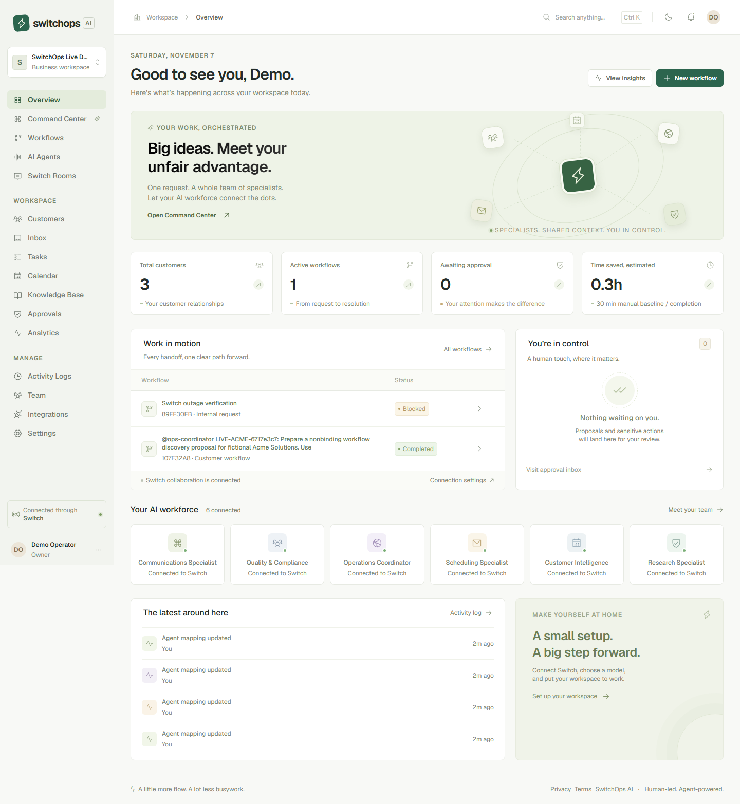
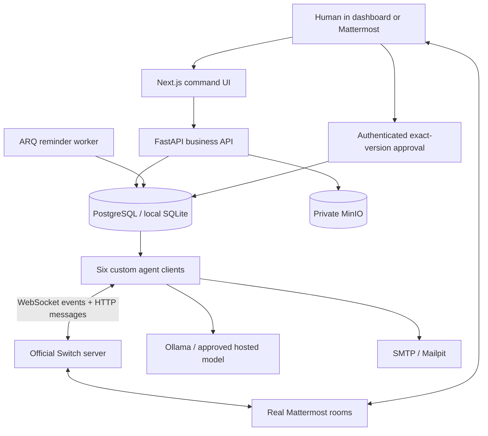

# SwitchOps AI

**Your AI Workforce. Your Team. One Command Center.**

A human-led business operations workspace for the Flip the Switch Hackathon. SwitchOps combines CRM, durable requests, six specialist agents, cited research, versioned proposals, exact-payload human approvals, SMTP execution and internal follow-ups. SQL is the business source of truth. **Genuine Switch Rooms carry every specialist handoff.**

The live local sandbox workflow is now verified with real Google Gemini inference, official Switch 0.31.0, Mattermost, PostgreSQL, Redis, MinIO and Mailpit. Six agents completed the fictional Acme request through human-approved proposal v2, one sandbox email and persisted follow-up. See the [live verification report](docs/LIVE_VERIFICATION.md), [test history](docs/VERIFICATION.md) and [acceptance matrix](docs/ACCEPTANCE.md). This is not a production-readiness certification.



## What is implemented

- Responsive Next.js command center with all 16 requested sections, light/dark mode, keyboard navigation, dialogs, notifications and error/empty states.
- Registration, Argon2id passwords, revocable HTTP-only sessions, CSRF, five backend-enforced roles and organization membership switching.
- Tenant-scoped CRM CRUD/archive/search/stages, duplicate checks, CSV import/export and customer detail/history.
- Durable workflow requests, idempotency keys, validated transitions, detail timelines, cancellation and explicit human retry.
- Six separate custom Switch identities and scoped prompts; actual WebSocket transport, HTTP operations discovery, persisted cursors, heartbeat pongs, reconnect backoff, generation fencing, event deduplication and exact sender/room checks.
- Customer research → drafting → quality review → immutable version approval → SMTP send attempt → internal follow-up. The deterministic suite exercises this full path through a protocol test double.
- Versioned Markdown proposals, downloadable branded PDFs, human editing that requires a fresh review, expiring approvals and one-time external execution claims.
- Task list/board, manual inbox, internal calendar with timezone-aware conflict detection and ICS export.
- Safe-size PDF/DOCX/TXT/Markdown text extraction, scoped chunks, cited keyword retrieval; configurable local embeddings and a PostgreSQL pgvector migration.
- Ollama and OpenAI-compatible structured output, availability checks, execution errors, persisted workflow usage and explicit external-provider privacy consent.
- Inbox model classification/suggested draft API; Google OAuth/token refresh/free-busy API; private MinIO object writes; ARQ overdue reminders.
- Real database analytics, audit logs, authenticated SSE invalidation, development-only synthetic seed action, Docker deployment definitions and CI.

Some secondary features from the broad brief remain incomplete, including live email ingestion, Gmail OAuth, approved external calendar invitations, drag/drop/dependency/attachment task features, document visual diff, generalized sensitive-action approval types, automated retention purge and external research. They are not advertised as implemented. The core workflow and local business functions are the priority. See the acceptance matrix.

## Architecture



The runtime is deliberately not a private agent bus. A specialist only starts when Switch delivers a genuine, addressed event from the expected verified participant. The coordinator may initiate a durable dashboard request only while its Switch room connection is live. Disconnect Switch and requests block visibly; records remain readable.

## Requirements

- Windows 10/11, PowerShell, Node 24+, Python 3.12+, Git.
- For the full service stack: Docker Desktop with Linux containers and Compose v2.
- For real collaboration: the official Switch Console/server and a supported Mattermost deployment; owner-created registration key and verified room/participant IDs.
- For real inference: a running Ollama model or your own OpenAI-compatible credentials. Switch does not supply an LLM. Qwen3 8B requires suitable memory/compute; no model is downloaded automatically.

## Windows local startup

From PowerShell in this repository:

```powershell
Set-Location C:\switch_hackathon
.\scripts\windows\setup.ps1
```

Open two terminals:

```powershell
.\scripts\windows\start.ps1 api
```

```powershell
.\scripts\windows\start.ps1 web
```

- Frontend: http://localhost:3000
- API/OpenAPI UI: http://localhost:8000/docs
- Health: http://localhost:8000/api/v1/health
- Mattermost URL: supplied by your actual Switch deployment; no URL is invented here.

Create your own account and workspace in the browser. There is no hardcoded login or shared default password. The first member owns the organization. To explore, use **Overview → Explore with labeled sample data**. This creates synthetic customers, tasks and service knowledge; it does not simulate agent runs or manufacture analytics.

`setup.ps1` creates a Python virtual environment, installs pinned dependencies, generates private secrets once, runs Alembic and installs the exact npm lockfile. SQLite is the local convenience store. Production uses PostgreSQL. `.env` and data files are ignored.

## Linux/macOS

```sh
sh scripts/linux/setup.sh
PYTHONPATH=services/api:services .venv/bin/python -m uvicorn app.main:app --host 127.0.0.1 --port 8000
# In another terminal
npm run dev --prefix apps/web
```

## Docker

Generate `.env` first with the setup script or `python scripts/init_env.py`, then:

```powershell
docker compose config --quiet
docker compose up --build -d
docker compose logs -f api agents
```

Services: web (3000), API (8000), PostgreSQL/pgvector, Redis, MinIO (console 9101), Mailpit (8025), reminder worker and custom agent runtime. Switch Console manages its own separate stack. No substitute Switch image is bundled. Database/Redis/MinIO APIs are not exposed publicly.

Migration is a dedicated one-shot Compose service. Manual migration:

```powershell
docker compose run --rm migrate
# Local SQLite or a configured local PostgreSQL URL:
$env:PYTHONPATH='services/api;services'
.venv\Scripts\alembic upgrade head
```

Optional Ollama profile:

```powershell
docker compose --profile local-ai up -d ollama
docker compose exec ollama ollama pull qwen3:8b
```

In the Docker organization’s model configuration, use `http://ollama:11434` for that profile or `http://host.docker.internal:11434` for a host installation. With host-only local development, use `http://localhost:11434`. The stored organization configuration takes precedence over environment defaults.

For production, use a TLS reverse proxy and:

```powershell
docker compose -f docker-compose.yml -f docker-compose.prod.yml up --build -d
```

Production cookies require HTTPS. Configure the real HTTPS `FRONTEND_URL`, `BACKEND_URL`, restricted ingress, backups and external provider policy first. The production overlay intentionally retains the sandbox email sink. Do not claim a production deployment from a successful local build.

## Switch and agent setup

Follow [the exact onboarding guide](switch/onboarding/README.md). The [official protocol](https://docs.switchagents.ai/switch-rooms/internals/agent-protocol) documents registration, authenticated WebSockets and HTTP operations. The [official template reference](https://docs.switchagents.ai/switch-rooms/administer/room-templates) and linked upstream template language informed the included version-1 group YAML.

1. Install Switch Console and configure its supported Switch server and Mattermost bridge.
2. Add the genuine bridge URL and registration key in **Integrations**.
3. Register six agents in **AI Agents**, preserving each one-time credential.
4. Import `switch/templates/business-workspace.yaml` in Switch Console.
5. Map exact participant IDs and operations-hub membership for all six agents; map the room and its real Mattermost URL.
6. Set default room and verified human identity mappings in Settings.
7. Configure/test the model; start the runtime:

```powershell
.\scripts\windows\start.ps1 agents
# Optional reminder worker, requires Redis:
.\scripts\windows\start.ps1 worker
```

Switch liveness derives from actual pongs; stale agents display disconnected. There are no random status changes. A gap, takeover, rejected credential or room denial requires inspection and explicit remapping/reconciliation. Registration never uses `overwrite: true`. One workspace per Switch identity namespace is the currently supported topology.

## Model, email and calendar

In **Integrations → AI model provider**, choose Ollama, provide its base URL and installed model name, then test. Hosted providers need their `/v1` compatible base URL and API key; explicitly authorize external processing of private data. Credentials remain encrypted in SQL using `APP_ENCRYPTION_KEY`, never returned to the client.

The [Ollama chat API](https://docs.ollama.com/api/chat) is called with a JSON schema and `stream:false`. Invalid or missing inference produces an actionable error, never a canned proposal.

For local Mailpit outside Compose, set `SMTP_HOST` and `SMTP_PORT=1025`; Compose supplies these internally. Approving an action authorizes exactly one recipient and version. `sandbox_accepted` or `smtp_accepted` means SMTP acceptance, **not confirmed customer delivery**. An ambiguous send outcome is never retried automatically.

Google Calendar OAuth needs server-side `GOOGLE_CLIENT_ID`, `GOOGLE_CLIENT_SECRET` and the exact configured callback URI. The API implements consent state binding, encrypted refresh tokens and actual [Calendar free/busy queries](https://developers.google.com/workspace/calendar/api/v3/reference/freebusy/query). This optional path is unverified without credentials. Internal calendar events never send invitations.

## Testing

```powershell
$env:PYTHONPATH='services/api;services'
.venv\Scripts\python -m pytest -q
npm run typecheck --prefix apps/web
npm run build --prefix apps/web
Push-Location apps/web
npx playwright install chromium
npm run test:e2e
Pop-Location
docker compose config --quiet
.venv\Scripts\python scripts/doctor.py
```

The backend suite uses a fresh in-memory test database per test. It covers authentication, CSRF, roles, tenant isolation, CRUD, idempotency, state transitions, approval replay/expiry, retrieval, task/calendar validation, registration/key preservation, discovery/permission errors, cursor replay, pongs, takeover/gap and the complete deterministic workflow. Network/model/provider fixtures exist exclusively in tests. Playwright uses a separate `.data/e2e.db` and ports 3011/8011; its proposal fixture explicitly labels synthetic output and cannot run against a different database.

The full Switch/LLM/Mattermost/Mailpit live acceptance run is separate and requires actual configured services. See [demo script](docs/hackathon/DEMO_SCRIPT.md).

## Security and limitations

Read [security notes](docs/security/SECURITY.md). Important current limits: local in-process rate limits require a shared gateway for multi-replica deployments; self-service registration has no email verification; no password reset/MFA; extraction is size-limited but not yet isolated in an OS sandbox; analytics are scoped, capped lists are not a high-volume reporting warehouse; automatic retention purge is disabled. A qualified security review is required before sensitive production use.

## Repository guide

| Directory | Purpose |
|---|---|
| `apps/web` | Next.js App Router interface and Playwright test |
| `services/api/app` | FastAPI, domain models, auth, business rules, integrations |
| `services/api/alembic` | Versioned database migrations |
| `services/agents` | Six agent definitions and genuine Switch runtime |
| `switch` | Official-format template and onboarding |
| `infra/docker` | Business service Dockerfiles |
| `scripts` | Windows/Linux setup, doctor, OpenAPI export and isolated QA fixtures |
| `tests/integration` | Full deterministic Switch protocol workflow |
| `docs/hackathon` | Switch explanation, demo and submission material |

## Troubleshooting

- **Missing tables:** run Alembic with the same `DATABASE_URL` and working directory as the API.
- **Frontend cannot reach API:** start port 8000 first. Docker builds configure the internal `api:8000` rewrite. If changing the baked destination for a production build, rebuild it.
- **403 on writes:** refresh/sign in again for a fresh CSRF token; verify your role and configured origin.
- **Workflow blocked:** open its actual error and timeline. Check Switch connectivity, room claims, verified participant mappings, model and SMTP. Retry after addressing the cause. A prior email attempt requires manual provider reconciliation.
- **Agent registered but addressing failed:** its key is already preserved. Set `owner_and_owner_agents` in Switch Console, then finish mappings.
- **Docker daemon missing:** start Docker Desktop with Linux containers. The Docker CLI alone cannot run services.
- **Windows PowerShell refuses a `.ps1`:** run the equivalent listed commands manually or use a process-scoped execution policy consistent with your machine policy; the app does not change system policy.
- **No model:** install/configure a real model. Switch itself does not provide inference.
- **MinIO failure:** check internal endpoint/access credentials. Files never fall back to public hosting.

## License and acknowledgements

SwitchOps source is MIT licensed. Third-party packages retain their licenses; see [dependencies and licensing](docs/DEPENDENCIES.md). Switch, Mattermost, MinIO and models have separate terms. Nothing here claims endorsement or grants rights to third-party brands. Hackathon submission material is in `docs/hackathon`; no live deployment, repository submission URL or recorded video is fabricated.
